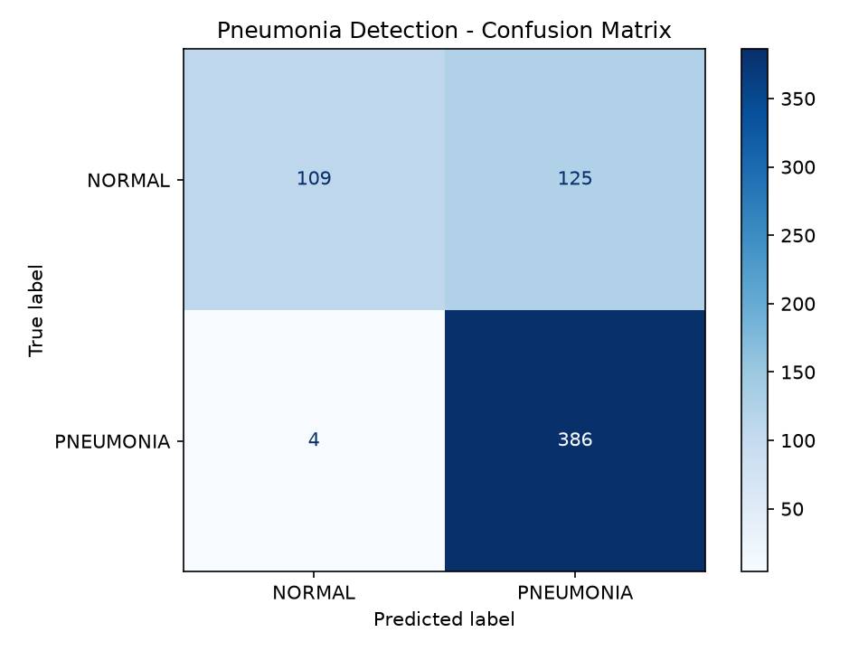
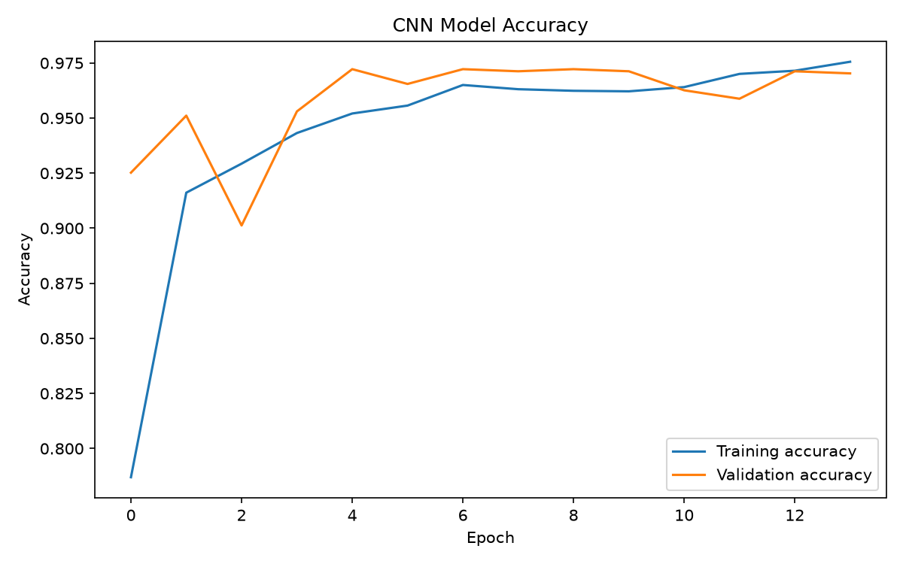
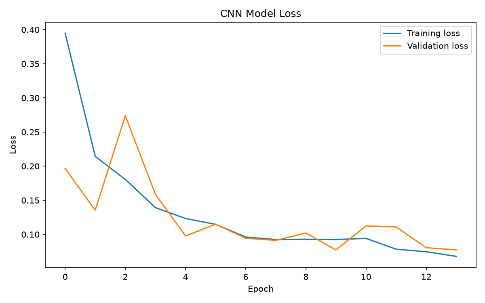

# Pneumonia Detection using CNN

An educational Deep Learning project that trains a Convolutional Neural
Network (CNN) to classify chest X-ray images into `NORMAL` and `PNEUMONIA`
categories.

> **Medical disclaimer:** This is an educational prototype, not a medical
> device or diagnostic tool. It has not been clinically validated and must
> not be used for diagnosis, treatment, triage, or other clinical decisions.

## 1. Dataset

Download the **Chest X-Ray Images (Pneumonia)** dataset by Paul Mooney:

https://www.kaggle.com/datasets/paultimothymooney/chest-xray-pneumonia

Extract the archive so the project has this structure:

```text
data/
└── chest_xray/
    ├── train/
    │   ├── NORMAL/
    │   └── PNEUMONIA/
    ├── val/
    │   ├── NORMAL/
    │   └── PNEUMONIA/
    └── test/
        ├── NORMAL/
        └── PNEUMONIA/
```

The training script creates its own 80:20 training/validation split from the
original `train` folder. It intentionally does not use the tiny original
`val` folder. The original `test` folder is held out for final evaluation.

**Dataset caution:** This dataset may contain correlated images from the same
patient and has known population/source limitations. A patient-wise split
and independent external validation are preferable for stronger research.
Do not assume performance generalizes to other hospitals, populations,
equipment, or adult patients.

## 2. Environment setup

Python 3.10 or 3.11 is a practical starting point. Create and activate a
virtual environment:

```bash
python -m venv .venv
```

Windows PowerShell:

```powershell
.venv\Scripts\Activate.ps1
```

macOS/Linux:

```bash
source .venv/bin/activate
```

Install dependencies:

```bash
pip install -r requirements.txt
```

If TensorFlow installation fails, check the TensorFlow installation guide
for your operating system and Python version:
https://www.tensorflow.org/install

## 3. Train and evaluate

From the project root:

```bash
python train.py
```

The script:
- Loads grayscale images resized to 224 x 224.
- Creates a reproducible 80:20 train/validation split.
- Applies light training-time augmentation.
- Uses class weights to address class imbalance.
- Trains a small CNN with early stopping and learning-rate reduction.
- Saves the best model to `models/pneumonia_cnn.keras`.
- Writes plots and evaluation outputs to `outputs/`.

Evaluation includes precision, recall, F1-score, confusion matrix, and
ROC-AUC. Review pneumonia recall and false negatives carefully; accuracy
alone is not sufficient for a medical-image classification task.

## 4. Run the Streamlit demo

After training:

```bash
streamlit run app.py
```

Upload a JPG, JPEG, or PNG image to see the model's raw output. The displayed
score is not a clinically calibrated probability.

## 5. Project structure

```text
Pneumonia-Detection-using-CNN/
├── data/                  # Download dataset here; not committed to Git
├── models/                # Trained model; not committed to Git
├── outputs/               # Evaluation plots and reports
├── train.py
├── app.py
├── requirements.txt
├── .gitignore
└── README.md
```

## 6. Suggested improvements

- Compare class-weighted and unweighted training.
- Use patient-level splitting if patient identifiers are available.
- Add Grad-CAM for model explainability.
- Evaluate on an independent external dataset.
- Study threshold selection and sensitivity/specificity trade-offs.
- Add automated tests and record exact dependency versions.

## 7. Resume description

**Pneumonia Detection using CNN | Deep Learning**

- Built a CNN image-classification pipeline for NORMAL and PNEUMONIA
  chest X-ray categories using Python and TensorFlow/Keras.
- Implemented image preprocessing, data augmentation, class weighting,
  model training, and held-out evaluation.
- Evaluated model performance using precision, recall, F1-score,
  confusion matrix, and ROC-AUC.
- Developed an educational Streamlit interface for image upload and
  model inference.

Only include results and features you have actually completed. Do not claim
clinical accuracy or clinical suitability.


## 2. Technologies Used

- Python
- TensorFlow and Keras
- Convolutional Neural Network (CNN)
- Streamlit
- NumPy
- Matplotlib
- Scikit-learn
- Pillow (PIL)

## 3. Project Features

- Chest X-ray image classification
- Image preprocessing
- CNN model training
- Normal and Pneumonia prediction
- Model performance evaluation
- Confusion Matrix visualization
- Training and Validation Accuracy graphs
- Interactive Streamlit web application

## 4. Model Performance

The trained CNN model was evaluated using test data.

| Metric | Result |
|---|---:|
| Test Accuracy | 82% |
| ROC-AUC Score | 0.9028 |
| Weighted F1-Score | 0.80 |

## 5. Evaluation Results

### Confusion Matrix


### Training Accuracy


### Training Loss


## 6. Installation and Setup

Clone the repository:

```bash
git clone https://github.com/Punit-patel-91/Pneumonia-Detection-using-CNN.git
```

Navigate to the project folder:

```bash
cd Pneumonia-Detection-using-CNN
```

Install dependencies:

```bash
pip install -r requirements.txt
```

Run the Streamlit application:

```bash
streamlit run app.py
```

## 7. Model Training

To train the CNN model, run:

```bash
python train.py
```

## 8. Future Improvements

- Improve classification performance
- Reduce false predictions
- Experiment with transfer learning
- Improve model generalization

## 9. Disclaimer

This project is developed for educational purposes only.
It is not intended for real-world medical diagnosis or treatment.
